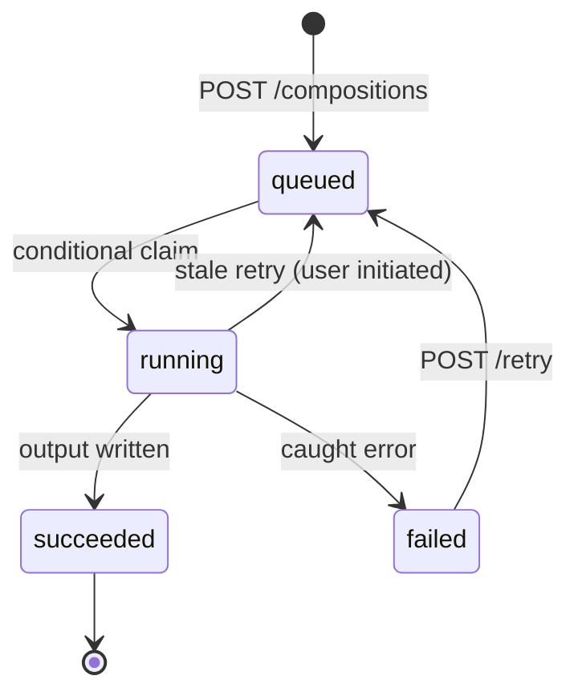

# Compose job contract (T0)

Part of [T0 — Foundation](../tickets/phase-0-foundation.md). Decisions: D-11 (contract
now, service later), D-24 (queued job with persisted status and explicit retry), and D-25
(composition id only in the job argument). Related: [Background-job spike](spike-background-jobs.md),
[Domain schema](domain-schema.md), [OpenAPI draft](../../../openapi.draft.yaml).

## Scope

The MVP composition worker is local PHP. It turns a structure and its tag-based rules
into one self-contained Markdown file. DOCX and the separate compose server are out of
scope (D-06). The contract is the boundary the separate service will implement later.

## Queue contract

1. `POST /books/{bookId}/compositions` validates the structure and rules, inserts the
   `compositions` row (`status=queued`) and `composition_rules` in one transaction, then
   enqueues the job.
2. The job argument is exactly:

   ```json
   {"compositionId": 42}
   ```

   No file contents, paths, keys, prompts, or user text. Arguments are visible in the
   job table and `background-job:list` (spike finding).

3. The job class is `OCA\BookTailor\BackgroundJob\ComposeJob extends QueuedJob`.
4. The HTTP response is `202` with the composition in `queued`; clients poll
   `GET /compositions/{id}`.

## State machine



- The worker claims with `UPDATE compositions SET status='running', started_at=NOW()
  WHERE id=? AND status='queued'`. If zero rows change, it exits: another worker already
  claimed it.
- `succeeded` requires the output file id and path; `failed` requires an actionable
  error. Both set `completed_at`.
- The job list removes the `QueuedJob` before `run()`; the app state machine is the
  retry authority (D-24).
- A `running` row whose `started_at` is older than 30 minutes is reported as stale by the
  API (a computed flag; the stored status stays `running`). Retrying it is explicit and
  user-initiated.
- Automatic retries are out of scope for the MVP. Add them only with idempotent output
  handling and an attempts field.

## Worker steps

1. Load the composition, book, structure, entries, assets, tags, and rules in batched
   queries. Do not query per asset (N+1).
2. Verify the book and owner still exist. A deleted book cascades the composition; the
   worker exits without writing.
3. Resolve included chapters from the structure entries and the canonical tree (D-17).
4. Evaluate rules in priority order with fallback (exact precedence frozen in T5).
5. For each included chapter, select and merge assets in the defined order; render
   structure-based numbering and headings.
6. Resolve Markdown image references, copy the images beside the output, and rewrite the
   links so the result is self-contained (D-16; exact layout frozen in T5).
7. Write the output to `/BookTailor/<book>/compositions/` using the owner's
   `IRootFolder::getUserFolder()`; never use a user-supplied path.
8. Update the row to `succeeded` with `output_file_id`, `output_path`, and
   `completed_at`.

Output naming is a T5 detail; the draft convention is
`<structure-slug>-<YYYYMMDD-HHMMSS>.md`, with ` (2)`, ` (3)`, … on collision.

## Idempotency and failure

- If a composition is already `succeeded`, a re-run exits without writing a second file.
- Write to a temporary file, then move/rename it into place; update the DB after the move.
  If the DB update fails, the orphaned output is reconciled by path on the next attempt.
- Catch `Throwable`; record a short, user-safe error (for example, “Chapter X has no
  matching assets”). Log the exception with composition id, book id, owner, and duration.
  Do not log content or secrets.
- Hard crashes leave `running`; stale detection plus explicit retry is the recovery path.
- Never write outside the owner's folder and never follow symlinks or `..` segments.

## API and status shape

- `Composition.status`: `queued`, `running`, `succeeded`, `failed`.
- `Composition.error`: null on success; an actionable message on failure.
- `outputFileId` / `outputPath`: set only on success.
- `202` on create and retry; `409` if retry is requested for a non-failed, non-stale
  composition; `404` for a non-owned composition.
- The API contract is in [openapi.draft.yaml](../../../openapi.draft.yaml).

## Concurrency and permissions

- Composition writes are owner-scoped; the worker runs without a session and resolves the
  owner from the composition/book row.
- The conditional claim prevents duplicate execution from parallel cron workers.
- One composition, one worker. Do not add a global job lock that would serialize all
  books.
- Composition does not call Langfuse; AI tracing is only for AI calls.

## Fallback

If no background worker runs, the row stays `queued` and the UI shows that state. If the
worker is unavailable in a deployment, the API can return the queued row and the user can
retry later; do not run composition synchronously in the HTTP request for the MVP.

## Open questions (T5/T6)

- Exact rule precedence, fallback, and per-chapter overrides (T5).
- Final output naming and image folder layout (T5).
- Stale threshold, heartbeat, and whether to add an attempts column (T5).
- Auto-retry policy after the MVP (T5).
