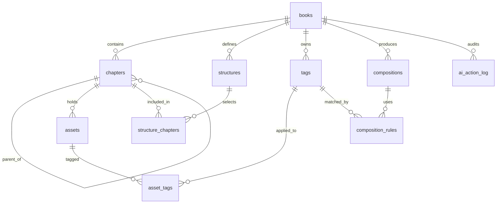

# Domain schema and storage layout (T0)

Part of [T0 — Foundation](../tickets/phase-0-foundation.md). Requirements live in the
[MVP specification](../specs/booktailor-mvp.md). Decisions referenced here are recorded
in [decisions.md](../../decisions.md).

## Glossary

| Term | Definition |
|---|---|
| **Book** | A user's workspace. Owns chapters, structures, tags, compositions, and the visible folder. Has exactly one owner in the MVP. |
| **Chapter** | A node in the book's global chapter hierarchy. Holds assets and child chapters. The hierarchy is canonical; structures only select and order it. |
| **Structure** | A named, ordered, partially inclusive view of the chapter tree. Every book has one non-deletable default structure. |
| **Default structure** | The structure that always includes every chapter. It replaces the draft's “default chapter” concept (D-14). |
| **Structure entry** | A row binding a chapter to a structure with an `included` flag and a sibling `position`. |
| **Inclusion** | Whether a chapter is rendered in a given structure. Excluded chapters still exist and can have included descendants. |
| **Effective parent** | The nearest included ancestor of a chapter in a structure; if none, the chapter renders at the top level. Derived at read time (D-17). |
| **Asset** | A Markdown file inside a chapter; the content source of truth remains the Nextcloud file. |
| **Tag** | A free-form label owned by a book, used to classify assets and to drive composition rules. Per-book scope (D-15). |
| **Version ref** | A Nextcloud-native version identifier for an asset file (the revision timestamp). Check-in messages are stored as native version metadata (D-19). |
| **Composition** | An asynchronous generation of one Markdown document from a structure, using tag rules. |
| **Composition rule** | An ordered tag-based selection rule belonging to one composition. Exact precedence is frozen in T5. |
| **AI action** | A proposed or applied AI mutation, recorded for audit and confirmation. |
| **Visible folder** | The human-readable folder under the user's Files that mirrors the canonical chapter tree (D-13). |

## Entity relationships



## Conceptual schema

Types are DB-agnostic. Migrations target MySQL/MariaDB, PostgreSQL, and SQLite, so
timestamps are UTC `DATETIME`, booleans are `BOOLEAN`, and JSON payloads are `TEXT`
(encoded by the application). No database enums.

### `books`

| Column | Type | Notes |
|---|---|---|
| `id` | BIGINT PK | auto-increment |
| `user_id` | VARCHAR(64) | Nextcloud uid; owner |
| `name` | VARCHAR(255) | display name |
| `description` | TEXT NULL | optional |
| `root_file_id` | BIGINT NULL | Nextcloud file ID of the book folder |
| `created_at` | DATETIME | |
| `updated_at` | DATETIME | |

Index: `(user_id)`. `root_file_id` is unique when present.

### `chapters`

| Column | Type | Notes |
|---|---|---|
| `id` | BIGINT PK | |
| `book_id` | BIGINT FK → books | `ON DELETE CASCADE` |
| `parent_id` | BIGINT NULL FK → chapters | `ON DELETE CASCADE`; same book enforced on write |
| `name` | VARCHAR(255) | display name; duplicates allowed, folder names de-duplicated |
| `file_id` | BIGINT NULL | Nextcloud file ID of the chapter folder |
| `created_at` | DATETIME | |
| `updated_at` | DATETIME | |

Indexes: `(book_id, parent_id)`, unique `(file_id)` when present. Sibling order is
**not** stored here; it belongs to structures.

### `structures`

| Column | Type | Notes |
|---|---|---|
| `id` | BIGINT PK | |
| `book_id` | BIGINT FK → books | `ON DELETE CASCADE` |
| `name` | VARCHAR(255) | unique per book |
| `is_default` | BOOLEAN | exactly one true row per book; enforced in the service layer |
| `created_at` | DATETIME | |
| `updated_at` | DATETIME | |

Index: `(book_id)`, unique `(book_id, name)`.

### `structure_chapters`

| Column | Type | Notes |
|---|---|---|
| `structure_id` | BIGINT FK → structures | `ON DELETE CASCADE` |
| `chapter_id` | BIGINT FK → chapters | `ON DELETE CASCADE` |
| `included` | BOOLEAN | default true |
| `position` | INT | order among canonical siblings **within this structure** |

Primary key `(structure_id, chapter_id)`; index `(chapter_id)`. Rows are created for
every chapter in every structure when the chapter is created; new chapters start
`included = true` with `position = max(sibling position) + 1`. Effective parents are
computed, never stored.

### `assets`

| Column | Type | Notes |
|---|---|---|
| `id` | BIGINT PK | |
| `chapter_id` | BIGINT FK → chapters | `ON DELETE CASCADE` |
| `name` | VARCHAR(255) | display name; unique per chapter |
| `file_name` | VARCHAR(255) | on-disk name including `.md`; unique per chapter |
| `file_id` | BIGINT NULL | Nextcloud file ID of the Markdown file |
| `created_at` | DATETIME | |
| `updated_at` | DATETIME | |

Indexes: unique `(chapter_id, name)`, unique `(chapter_id, file_name)`, unique
`(file_id)` when present.

### `tags`

| Column | Type | Notes |
|---|---|---|
| `id` | BIGINT PK | |
| `book_id` | BIGINT FK → books | `ON DELETE CASCADE` |
| `name` | VARCHAR(64) | display name |
| `slug` | VARCHAR(64) | normalized lookup key |

Unique `(book_id, slug)`. Renaming changes `name`; rules and assignments reference
`id`, so no rewrite is needed.

### `asset_tags`

`asset_id`, `tag_id` — composite PK, both FKs `ON DELETE CASCADE`; index on `tag_id`.

### Versions (no app table)

Versions are owned by the shipped `files_versions` app. The revision identifier is the
native revision timestamp; `author` and the BookTailor check-in message are stored in
the native per-version metadata (D-19, supersedes the sidecar part of D-05). The app
does not create a version table.

- List: `IVersionManager::getVersionsForFile($user, $file)`; returned order is
  oldest→newest, so the app sorts descending for history.
- The list includes the current revision (file mtime). It has no backing version file,
  so it is shown as the **Current** row only and never downloaded or restored.
- Message write: `getBackendForStorage()` → `IMetadataVersionBackend::setMetadataValue()`
  with keys `booktailor_message` (and `booktailor_author` when no session author is
  set). This path works on Nextcloud 31–35.
- Check-in labels the current revision after editing. On the next save, native
  versioning snapshots that revision and the message moves into history with it
  (D-21).
- Restore: `IVersionManager::rollback($version)` on a historical version only.

### `compositions`

| Column | Type | Notes |
|---|---|---|
| `id` | BIGINT PK | |
| `book_id` | BIGINT FK → books | `ON DELETE CASCADE` |
| `structure_id` | BIGINT NULL FK → structures | `ON DELETE SET NULL` |
| `structure_name` | VARCHAR(255) | snapshot for display after structure deletion |
| `status` | VARCHAR(16) | `queued`, `running`, `succeeded`, `failed` |
| `output_file_id` | BIGINT NULL | Nextcloud file ID of the output |
| `output_path` | VARCHAR(4000) NULL | path snapshot for display |
| `error` | TEXT NULL | actionable failure message |
| `created_at` | DATETIME | |
| `completed_at` | DATETIME NULL | |

Indexes: `(book_id, created_at)`, `(status)`.

### `composition_rules`

| Column | Type | Notes |
|---|---|---|
| `id` | BIGINT PK | |
| `composition_id` | BIGINT FK → compositions | `ON DELETE CASCADE` |
| `tag_id` | BIGINT FK → tags | `ON DELETE CASCADE` |
| `priority` | INT | lower value evaluated first; exact semantics frozen in T5 |
| `fallback` | BOOLEAN | rule used only when no higher-priority rule matched |

Unique `(composition_id, priority, tag_id)`.

### `ai_action_log`

| Column | Type | Notes |
|---|---|---|
| `id` | BIGINT PK | |
| `user_id` | VARCHAR(64) | acting user |
| `book_id` | BIGINT NULL FK → books | `ON DELETE SET NULL`; audit survives book deletion |
| `action` | VARCHAR(64) | e.g. `create_asset`, `update_chapter` |
| `payload` | TEXT | JSON request/proposal |
| `status` | VARCHAR(16) | `proposed`, `applied`, `rejected`, `failed` |
| `created_at` | DATETIME | |

Indexes: `(book_id, created_at)`, `(user_id, created_at)`.

AI credentials are not part of the domain schema; T6 decides protected storage
(Nextcloud secret storage or equivalent) and the provider settings shape.

## Ordering, inclusion, and numbering

Given a structure:

1. Load its chapters and structure entries.
2. Build the canonical hierarchy; order each sibling group by
   `structure_chapters.position`.
3. Keep only included chapters. For each included chapter, its effective parent is the
   nearest included ancestor; if none exists it renders at the top level.
4. Flatten in depth-first order and number: top-level `1.`, `2.`; children `1.1`,
   `1.2`; grandchildren `1.1.1`.
5. Excluded chapters still contribute their included descendants — those descendants
   surface at the nearest included ancestor's level (or top level).

Invariants enforced on write:

- A chapter's parent belongs to the same book; no cycles.
- A structure and all its entries belong to the same book as the chapters.
- Exactly one default structure per book; it always has `included = true` for every
  chapter, including newly created ones.
- Deleting a chapter removes all its structure entries and descendants.
- Deleting a tag cascades to `asset_tags` and `composition_rules`.
- Version messages live in native version metadata and expire with the version; the app
  never keeps a parallel version table.

## Visible-folder layout

The folder tree mirrors the **canonical chapter hierarchy**, never a structure (D-13).
Structures are a database-only view concept.

```
/BookTailor/
  <book>/
    <chapter>/
      <asset>.md
      images/
        <image files>
    <nested chapter>/
      ...
    compositions/
      <structure-slug>-<YYYYMMDD-HHMMSS>.md
```

- `/BookTailor` is created lazily in the owner's Files root.
- Folder and file names derive from display names, sanitized for the filesystem and
  de-duplicated with ` (2)`, ` (3)`, … The display name stays in the database; the
  visible name may differ.
- Images belong to the chapter (shared by its assets) and are referenced from Markdown
  as relative `images/<file>` paths (D-16).
- Composition outputs live under the book's `compositions/` folder; T5 finalizes
  naming.

## File identity and mutation behavior

`root_file_id`, `chapters.file_id`, `assets.file_id`, and
`compositions.output_file_id` store Nextcloud file IDs. Paths are derived and are not
authoritative. File IDs survive renames and moves, so metadata never needs rewriting
when the visible path changes.

| Operation | File action | Metadata action |
|---|---|---|
| Create book | create `/BookTailor/<book>/` | insert book, default structure |
| Rename book | rename book folder | update `name`, keep IDs |
| Create chapter | create chapter folder | insert chapter; add entry to every structure |
| Rename chapter | rename chapter folder | update `name` |
| Reorder siblings | none | update `position` in one structure |
| Promote/demote/attach chapter | move folder subtree | update `parent_id`; no structure changes |
| Delete chapter | move subtree folder to Nextcloud trash | cascade chapters, assets, entries |
| Create/upload asset | create/upload `.md` in chapter folder | insert asset row |
| Rename asset | rename file | update `name`/`file_name` |
| Delete asset | move file to Nextcloud trash | delete asset row and dependents |
| Rename tag | none | update `name`/`slug` |
| Delete tag | none | cascade assignments and composition rules |

Create operations must check `nodeExists` first and de-duplicate names explicitly
(` (2)`, ` (3)`, …). The Nextcloud `newFile()`/`newFolder()` APIs return the existing
node when the path already exists instead of throwing, so a "create" can silently
reuse an existing file or folder (spike result). For uploads, `putContent()` would then
overwrite the existing file.

After any rename or move of a folder, re-fetch child nodes by path or file ID before
mutating them. A `Node` object captured before an ancestor move keeps its old path, and
`delete()` on such a stale node silently does nothing without throwing (spike result).

External changes made in Files are reconciled by file ID: if a file was moved, its path
is refreshed on next access; if it is gone, the asset is reported as unavailable rather
than silently recreated. Reconciliation details are implemented in T1/T4.

## Remaining T0 items

The schema and storage rules above resolve the T0 decision items. File
CRUD/move/delete and visible-folder behavior are verified in the
[file-operations spike](spike-file-operations.md); native versions and check-in
messages are verified in the [versions spike](spike-versions.md); the Text editor and
save/check-in flow are verified in the [editor spike](spike-editor.md). Still open:

- Background-job execution for composition.
- Langfuse and BYOK feasibility.
- OpenAPI draft and test harness verification.
